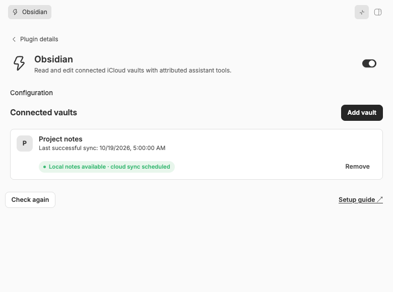

# PA for BB

**Turn BB into a personal assistant for your life.**

[BB](https://getbb.app) is an app for working with AI coding agents such as Claude Code, Codex and Pi. PA for BB extends it beyond coding: connect your calendar, email, documents and notes, then ask your assistant to help with the things you need to do.

- “What do I need to prepare for tomorrow's meetings?”
- “Find the planning document in Google Drive and summarise it.”
- “Find the open tasks in my project notes and add a note about today's decision.”

Choose the integrations you need and use them together in BB conversations. The goal is an assistant that helps you prepare, plan and follow through—not just a collection of service connections. See [the vision](docs/vision.md) for the intended experience; today's available plugins are listed below.

For a new installation, use the [Docker quick start](#docker-quick-start) or [Ansible/manual host setup](#ansible-or-manual-setup). Docker includes BB, the PA plugins and their dependencies. Already running BB? [Add the integrations you want](#2-add-the-marketplace-and-install-plugins).

## Available integrations

| Integration | What you can do | What you need |
| --- | --- | --- |
| [Xero](plugins/xero/README.md) | Discover and call Xero APIs for records, reports, requested writes and files, with guarded invoice/payment helpers. | Your own Xero Web OAuth app; extra services may need scopes or partner approval. [Setup guide](plugins/xero/README.md#install-and-connect). |
| [Google Workspace](plugins/google-workspace/README.md) | Use Drive, Docs, Sheets, Calendar and Gmail across connected Google accounts. Requested writes run without a second PA approval prompt. | Your own Google Web OAuth client and `uvx` on the BB service's PATH. [Setup guide](plugins/google-workspace/README.md#setup). |
| [Fastmail](plugins/fastmail/README.md) | Use Fastmail's mail, calendar and contacts tools. Available actions depend on the access you grant, including write/send access if selected. An optional API token enables Inbox and label updates. | One Fastmail account. [Setup guide](plugins/fastmail/docs/setup.md). |
| [MsgVault](plugins/email/README.md) | Archive and search selected Gmail and Fastmail accounts with MsgVault on the BB server. | Reuses Workspace Gmail and Fastmail JMAP connections. Included in Docker; otherwise requires MsgVault 0.26 and BB 0.50.1 or later on the server. |
| [iCloud Drive](plugins/icloud/README.md) | Sync selected folders in both directions between iCloud Drive and the BB host. | A supported Linux host with rclone. [Setup and recovery guide](plugins/icloud/docs/setup.md). |
| [Obsidian](plugins/obsidian/README.md) | Search, read, create and edit notes, properties and tasks across connected vaults. BB installs Desktop and its CLI when you connect a vault. | The iCloud plugin, an initialized synced vault, and the [Linux host requirements](provisioning/README.md#manifest-and-supported-host). [Setup guide](plugins/obsidian/docs/setup.md). |

These plugins are early-stage and intended for **single-user BB installations**, not shared servers. Listed capabilities are implemented, but not every action has been verified against a live account. Google Workspace replaces the retired standalone Calendar and Drive plugins. Each plugin guide records verification limits; an available tool catalog is not proof of every provider operation. PA core and other [planned integrations](docs/roadmap.md) are not available yet.

### Photos and Grain

[Photos](plugins/photos/README.md) browses and downloads iCloud Photos on demand and connects to a configurable Grain MCP endpoint. Follow its guide for local installation and connection setup.

### Experimental GTD inventories

The source checkout also includes a read-only [GTD plugin](plugins/gtd/README.md) with `bb gtd projects`, `bb gtd areas`, and corresponding agent tools. Its backend-independent model starts with an Obsidian adapter for configured Projects and Areas folders. Folder membership defines entries; no type property is required. It is not yet listed in the marketplace; see its guide for local installation and verification limits.

## Get started

### 1. Prepare the host

#### Docker quick start

On a **linux/amd64** Docker host:

```sh
docker pull ghcr.io/mattwynne/pa-bb:edge
docker run --rm --entrypoint python3 ghcr.io/mattwynne/pa-bb:edge \
  /opt/pa-bb/docker/obsidian_desktop_seccomp.py > obsidian-desktop-seccomp.json
docker volume create pa-bb-home
docker run -d --name pa-bb \
  -p 127.0.0.1:38886:38886 \
  --mount source=pa-bb-home,target=/home/bb \
  --cap-drop ALL --security-opt no-new-privileges \
  --security-opt "seccomp=$PWD/obsidian-desktop-seccomp.json" \
  --shm-size=1g --stop-timeout=60 \
  ghcr.io/mattwynne/pa-bb:edge
```

The Docker host must permit unprivileged user namespaces. Generate the verified
seccomp profile before creating the BB container so Chromium can start its own
sandbox. Keep the profile for future starts. For an existing container, apply
these options at its next planned replacement using the same backed-up home volume.

The public image needs no GitHub login. `edge` tracks successful builds from `main`;
these are development builds, not versioned releases. To keep a deployment fixed,
use a `sha-<full-commit-sha>` tag or image digest. See the [container guide](docker/README.md)
to build from source or update an existing container safely.

Open <http://localhost:38886> and finish BB setup. The container runs as a non-root
user and stores settings, credentials, synced files and workspaces in the named
volume. Keep it private and back it up; don't replace it with an empty bind mount.
For remote access, use an SSH tunnel or an authenticated TLS reverse proxy.

The [`Dockerfile`](Dockerfile) uses `node:24-bookworm-slim` and installs dependencies
directly—no Ansible or systemd. It includes BB, Pi, Codex, Claude Code,
uv/uvx, rclone, ripgrep, MsgVault and Chrome. Startup registers the PA plugins and official
Browser Automation, so **skip step 2** and [connect your services](#3-connect-your-services).
No accounts are connected and no sync is enabled automatically.

See the [container guide](docker/README.md) for logs, provider sign-in, persistence
and safe updates. The linux/amd64 image build, startup, health check and plugin
registration have been verified. Provider sign-in and browser automation still
need checks after account setup.

#### Ansible or manual setup

For manual setup, install [BB](https://getbb.app) **0.45 or later**, with Node.js **22 or later**, and configure an AI provider. The host is the computer running BB; it need not be the computer where you open its browser interface. Keep this installation private and for your own use.

**For iCloud and Obsidian, provision the Linux dependencies before installing the plugins.** The included [Ansible role and setup instructions](provisioning/README.md) make that repeatable:

- Supported provisioning target: **Ubuntu 24.04, x86_64**.
- Pinned rclone **1.76.0** for iCloud folder sync and ripgrep **14.1.0** for note search.
- Required locking and process-inspection support for safe background syncing.
- GTK 3 and permission for the BB user's Obsidian Desktop process to create its Chromium user namespace.

Use the dependency role from a reviewed Git revision in your own infrastructure project, or follow the [standalone playbook instructions](provisioning/README.md#consume-from-infrastructure). The dependency role installs host packages, including native Chrome; it does not install BB. The full [application playbook](provisioning/application.md) also installs stock BB and agent tools, configures the service, registers PA plugins and installs official Browser Automation. Neither route connects accounts or enables sync. You supply the machine, persistent storage and private configuration. The plugins never install system packages themselves.

Fastmail and Google Workspace do not need these iCloud/Obsidian dependencies. Workspace requires `uvx`; see its setup guide.

### 2. Add the marketplace and install plugins

**Using Docker or the full Ansible application playbook?** The PA plugins are already registered; continue to [step 3](#3-connect-your-services). These marketplace instructions are for an existing BB installation where you want to choose individual integrations.

The marketplace is a plugin catalog you add to BB. Adding it gives you a choice of integrations; it does not install them all. Add it once, then install a plugin—for example, Fastmail:

```sh
bb marketplace add git:https://github.com/mattwynne/pa-bb.git
bb marketplace refresh pa-for-bb
bb plugin install fastmail@pa-for-bb
```

If the marketplace is already registered, skip the first command. Replace `fastmail` with `google-workspace`, `icloud` or `obsidian` to install another integration. Adding or refreshing the marketplace **does not install or update plugins**.

### 3. Connect your services

Open the installed plugin's settings in BB and follow its setup guide. Then start a **fresh BB conversation** so the assistant can discover its tools. No service is connected merely by installing a plugin.

### Before connecting accounts

- **Google setup needs your own client.** Create a Google Cloud Web OAuth client and register the callback URL shown in BB. The marketplace supplies no shared Google credentials. Workspace requests combined access to Drive, Docs, Sheets, Calendar and Gmail.
- **Fastmail controls the granted access.** Choose the permissions at Fastmail sign-in. If the browser cannot open the final localhost redirect, paste that address into the plugin's protected field in BB—not into chat or logs.
- **Xero needs its own connection.** Register the exact callback shown in BB on your Xero Web app, then connect and check access. Financial changes require an explicit request. Broader scopes need an owner-selected reconnect; some APIs require Xero partner approval. Recording a payment does not send bank money, and final browser reconciliation stays manual.
- **Write permissions differ.** Workspace and Fastmail follow the access you grant without an extra plugin-specific confirmation. Connecting an Obsidian vault grants read/write access to the **whole vault**, including hidden folders, without per-edit confirmations.
- **Sync is not a backup.** iCloud changes and deletions can propagate both ways. An Obsidian save confirms a local save, not delivery to iCloud or another device. Use a disposable folder for your first sync test and keep separate backups.

## A look inside BB

These screenshots show the installed plugins in BB with **example accounts and vault data**, not real connected accounts. See [how they were captured](docs/screenshots/README.md).

### Connect your notes



## Further reading

- [Contributing](CONTRIBUTING.md) — local-path development with stock BB: edit → reload → try → commit/push, tests and shared UI workflow.
- [Vision](docs/vision.md) and [roadmap](docs/roadmap.md) — where the project is heading.
- [Plans and findings](docs/plans/README.md) — implementation history and verification evidence.
- [Docker deployment](docker/README.md) — build, run, persistent storage and updates.
- [Host provisioning](provisioning/README.md) — Linux dependency requirements and Ansible application setup.
- [BB references](docs/references/README.md) and [`marketplace.json`](marketplace.json) — host documentation and plugin catalog.
