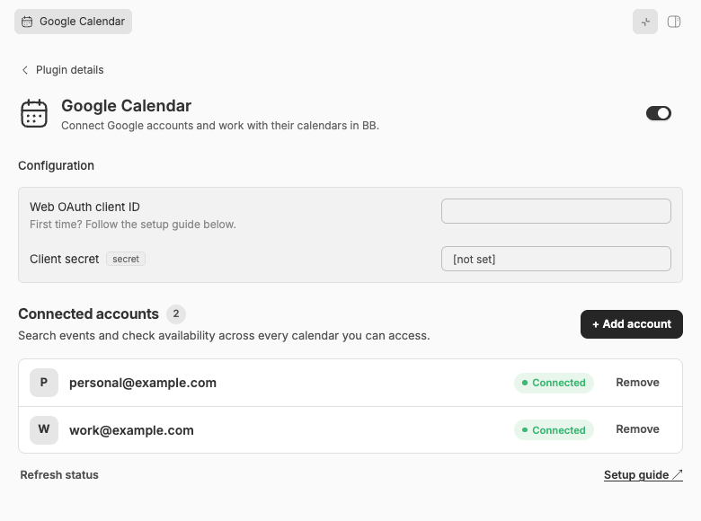
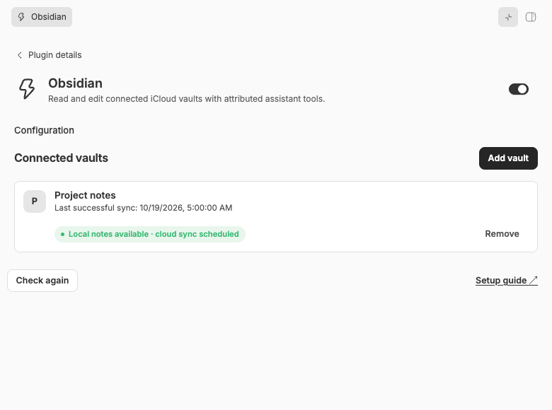

# PA for BB

**Turn BB into a personal assistant for your life.**

[BB](https://getbb.app) is an app for working with AI coding agents such as Claude Code, Codex and Pi. PA for BB extends it beyond coding: connect your calendar, email, documents and notes, then ask your assistant to help with the things you need to do.

- “What do I need to prepare for tomorrow's meetings?”
- “Find the planning document in Google Drive and summarise it.”
- “Find the open tasks in my project notes and add a note about today's decision.”

Choose the integrations you need and use them together in BB conversations. The goal is an assistant that helps you prepare, plan and follow through—not just a collection of service connections. See [the vision](docs/vision.md) for the intended experience; today's available plugins are listed below.

For a new installation, start with [host setup](#1-prepare-the-host). This repository includes **Ansible provisioning for the iCloud and Obsidian host dependencies**, as well as the plugins and their marketplace. Already running BB? [Add the integrations you want](#2-add-the-marketplace-and-install-plugins).

## Available integrations

| Integration | What you can do | What you need |
| --- | --- | --- |
| [Google Calendar](plugins/google-calendar/README.md) | Search events, check availability, and create, update or delete events after approval. Connect multiple Google accounts. | Your own Google Web OAuth client. [Setup guide](plugins/google-calendar/docs/google-oauth-setup.md). |
| [Fastmail](plugins/fastmail/README.md) | Use Fastmail's mail, calendar and contacts tools. Available actions depend on the access you grant, including write/send access if selected. An optional API token enables Inbox and label updates. | One Fastmail account. [Setup guide](plugins/fastmail/docs/setup.md). |
| [Google Drive & Docs](plugins/google-drive/README.md) | Find files, browse folders and read Google Docs across connected accounts. **Read-only.** | Your own Google Web OAuth client; Calendar and Drive can reuse its configuration while keeping separate account grants. [Setup guide](plugins/google-drive/docs/setup.md). |
| [iCloud Drive](plugins/icloud/README.md) | Sync selected folders in both directions between iCloud Drive and the BB host. | A supported Linux host with rclone. [Setup and recovery guide](plugins/icloud/docs/setup.md). |
| [Obsidian](plugins/obsidian/README.md) | Search, read, create and edit Markdown notes, properties and tasks across connected vaults. No Obsidian app or Mac relay required. | The iCloud plugin, an initialized synced vault, and the [host search requirements](provisioning/README.md). [Setup guide](plugins/obsidian/docs/setup.md). |

These plugins are early-stage and intended for **single-user BB installations**, not shared servers. Listed capabilities are implemented, but not every action has been verified against a live account. In particular, live Google Drive sign-in/reads, Calendar tool/approval flows, and Fastmail writes remain unverified; each plugin guide records its limits. PA core and other [planned integrations](docs/roadmap.md) are not available yet.

For a read-only review of published Calendar releases and local-work blockers,
install the optional [PA updates](plugins/pa-updates/README.md) plugin. It adds a
sidebar footer icon; it does not install updates or replace BB/Pi controls.

## Get started

### 1. Prepare the host

Install [BB](https://getbb.app) **0.45 or later**, with Node.js **22 or later**, and configure an AI provider. The host is the computer running BB; it need not be the computer where you open its browser interface. Keep this installation private and for your own use.

**For iCloud and Obsidian, provision the Linux dependencies before installing the plugins.** The included [Ansible role and setup instructions](provisioning/README.md) make that repeatable:

- Supported provisioning target: **Ubuntu 24.04, x86_64**.
- Pinned rclone **1.75.2** for iCloud folder sync and ripgrep **14.1.0** for note search.
- Required locking and process-inspection support for safe background syncing.

Use the role from a reviewed Git revision in your own infrastructure project, or follow the [standalone playbook instructions](provisioning/README.md#consume-from-infrastructure). It installs and checks dependencies only: **it does not create a server, install BB, connect accounts or enable sync**. You manage the host, persistent storage, service and private configuration. The plugins never install system packages themselves.

Calendar, Fastmail and Drive do not need these iCloud/Obsidian dependencies.

### 2. Add the marketplace and install plugins

The marketplace is a plugin catalog you add to BB. Adding it gives you a choice of integrations; it does not install them all. Add it once, then install a plugin—for example, Fastmail:

```sh
bb marketplace add git:https://github.com/mattwynne/pa-bb.git
bb marketplace refresh pa-for-bb
bb plugin install fastmail@pa-for-bb
```

If the marketplace is already registered, skip the first command. Replace `fastmail` with `google-calendar`, `google-drive`, `icloud`, `obsidian` or `pa-updates` to install another integration. Adding or refreshing the marketplace **does not install or update plugins**.

### 3. Connect your services

Open the installed plugin's settings in BB and follow its setup guide. Then start a **fresh BB conversation** so the assistant can discover its tools. No service is connected merely by installing a plugin.

### Before connecting accounts

- **Google setup needs your own client.** Create a Google Cloud Web OAuth client and register the callback URL shown in BB. The marketplace supplies no shared Google credentials. Calendar and Drive keep separate permissions even if they share client configuration.
- **Fastmail controls the granted access.** Choose the permissions at Fastmail sign-in. If the browser cannot open the final localhost redirect, paste that address into the plugin's protected field in BB—not into chat or logs.
- **Write permissions differ.** Calendar changes require approval. Fastmail follows the access you grant without an extra plugin-specific confirmation. Connecting an Obsidian vault grants read/write access to the **whole vault**, including hidden folders, without per-edit confirmations.
- **Sync is not a backup.** iCloud changes and deletions can propagate both ways. An Obsidian save confirms a local save, not delivery to iCloud or another device. Use a disposable folder for your first sync test and keep separate backups.

## A look inside BB

These screenshots show the installed plugins in BB with **example accounts and vault data**, not real connected accounts. See [how they were captured](docs/screenshots/README.md).

### Connect more than one calendar account



### Connect your notes



## Further reading

- [Contributing](CONTRIBUTING.md) — development setup, tests and shared UI workflow.
- [Vision](docs/vision.md) and [roadmap](docs/roadmap.md) — where the project is heading.
- [Plans and findings](docs/plans/README.md) — implementation history and verification evidence.
- [Host provisioning](provisioning/README.md) — portable Linux dependency requirements and Ansible role.
- [BB references](docs/references/README.md) and [`marketplace.json`](marketplace.json) — host documentation and plugin catalog.
